

<a href="https://vagdas.eu">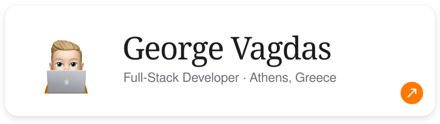</a>

Full-Stack Developer building fast, accessible web apps with React and TypeScript. 
5+ years across fintech, SaaS, e-commerce and hospitality. Currently learning Swift.

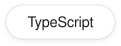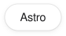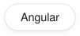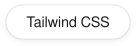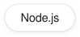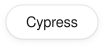

<a href="https://vagdas.eu/work/dromo">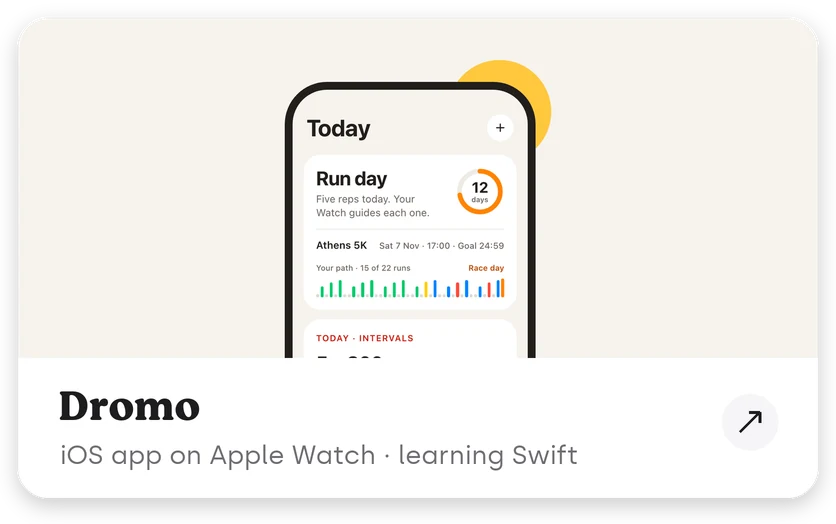</a><a href="https://vagdas.eu/work/budgard">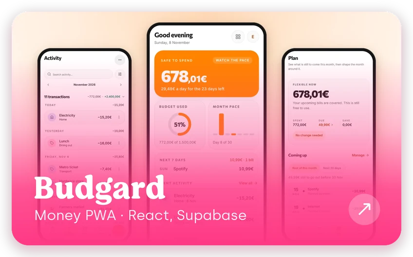</a> 
<a href="https://vagdas.eu/work/low-and-flow">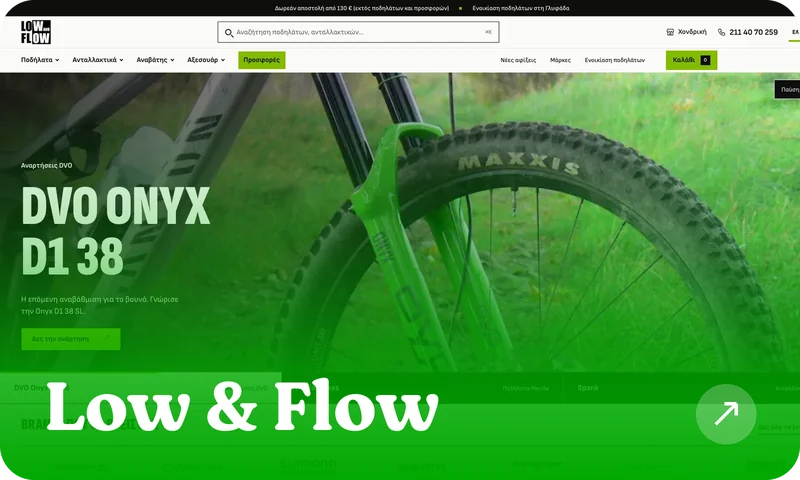</a><a href="https://vagdas.eu/work/the-kitchen-studio">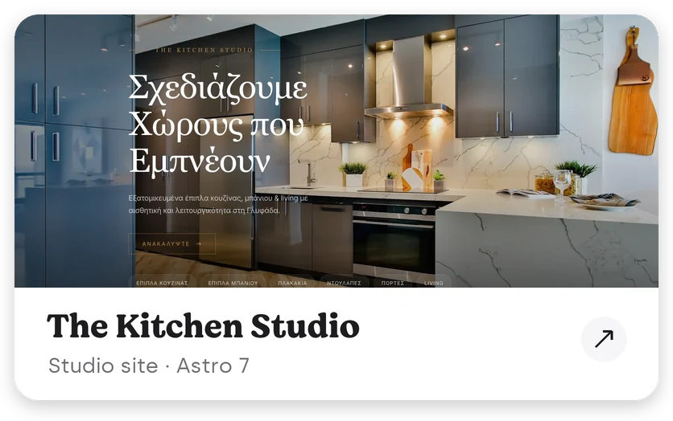</a> 
<a href="https://vagdas.eu/work/karadimas">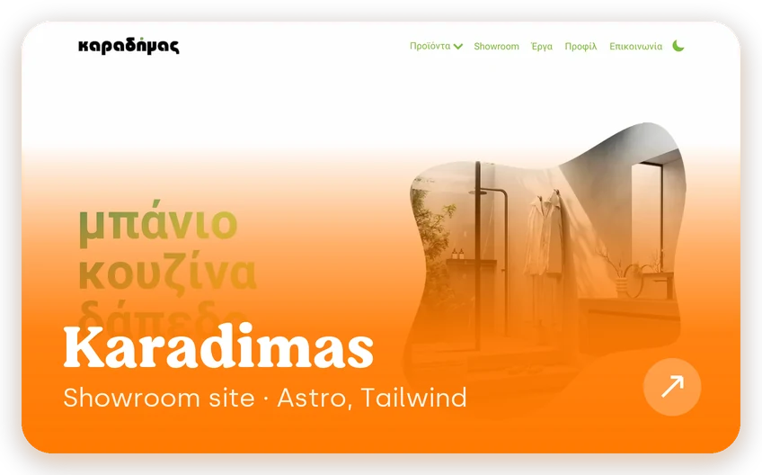</a><a href="https://vagdas.eu/work/vip-tour-transfer-kos">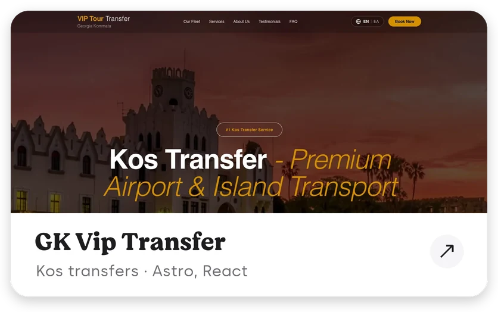</a>

<a href="https://github.com/georgevgs/trailwatch">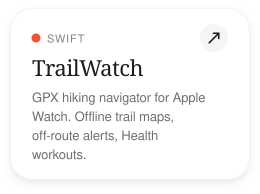</a><a href="https://github.com/georgevgs/closetly">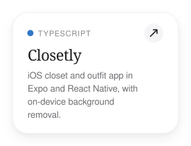</a> 
<a href="https://github.com/georgevgs/grocery-price-tracker">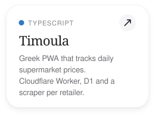</a><a href="https://github.com/georgevgs/card-trooper">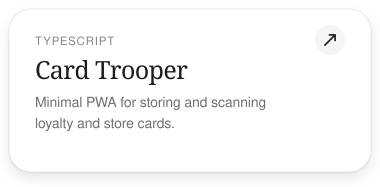</a>

<a href="mailto:dev@vagdas.eu">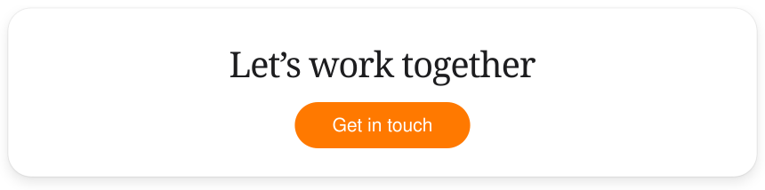</a>

