

<a href="https://vagdas.eu">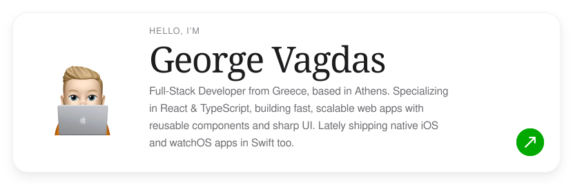</a>

<a href="https://vagdas.eu">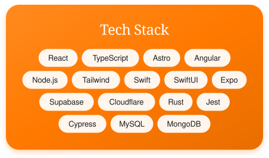</a><a href="https://www.linkedin.com/in/gvagdas">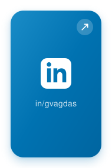</a><a href="https://github.com/georgevgs">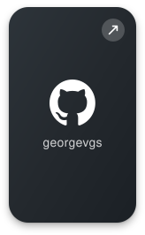</a>

<a href="https://vagdas.eu/work/dromo">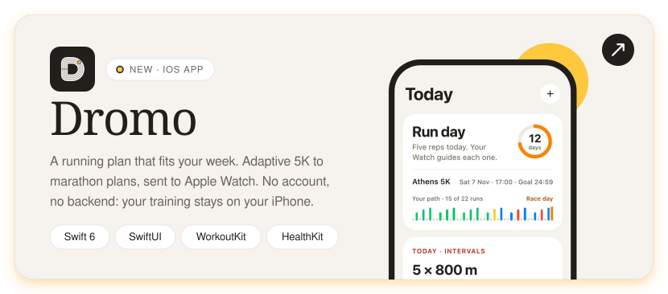</a>

<a href="https://vagdas.eu/work/budgard">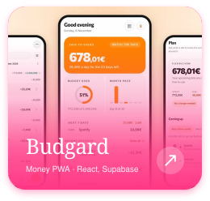</a><a href="https://vagdas.eu/work/low-and-flow">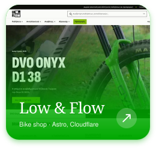</a><a href="https://vagdas.eu/work/the-kitchen-studio">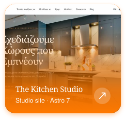</a>

<a href="https://vagdas.eu/work/karadimas">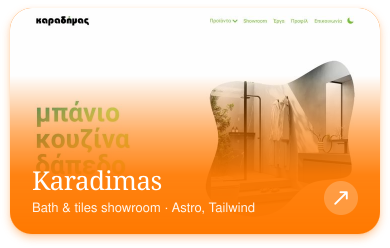</a><a href="https://vagdas.eu/work/vip-tour-transfer-kos">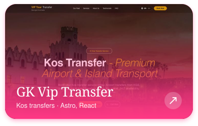</a>

<a href="https://github.com/georgevgs/gree-ac">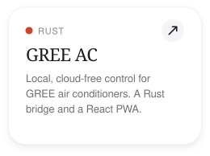</a><a href="https://github.com/georgevgs/gv-portfolio">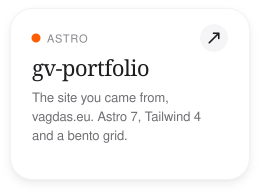</a>

Athens, Greece &nbsp;·&nbsp; <a href="https://vagdas.eu">vagdas.eu</a> &nbsp;·&nbsp; <a href="mailto:dev@vagdas.eu">dev@vagdas.eu</a>

