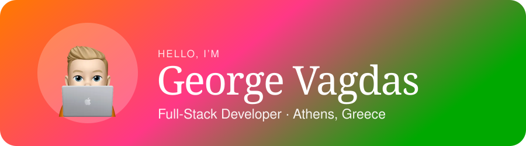
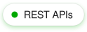
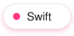
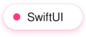

I build fast, scalable web apps with React and TypeScript: reusable components, solid architecture and a sharp UI. Over 5 years I've shipped products across fintech, SaaS, e-commerce and hospitality. I'm currently learning Swift and building my first iOS apps. I made my first website in 2013 and haven't stopped since.

 

 

 

 

 
 

 

